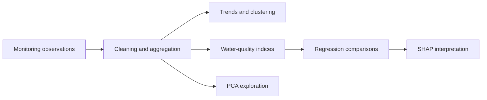

# Yellow River Water Quality Analysis
# 陕西省黄河流域水质分析、评价与预测

**Python · Environmental Data Analysis · Statistical Modeling · Extra Trees · SHAP**

[中文](#中文介绍) | [English](#english) | [Français](#français)

[论文 · Paper · Rapport](docs/paper-2025.pdf) · [数据 · Data · Données](data/README.md)

### 分析流程 · Workflow · Démarche



[数据与脚本导航 · Data guide · Guide des données](data/README.md) · [全部数据文件 · Data catalog · Catalogue](data/catalog.csv)

## 中文介绍

### 项目概述

本项目是 2025 年统计建模竞赛团队研究，聚焦陕西省黄河流域的水质变化，结合统计分析、水质指数评价和机器学习，研究三个问题：

- 水质指标随时间如何变化，是否呈现季节差异？
- 不同监测断面的水质特征有哪些相似性与差异？
- 如何利用水质指标和时间特征建立水质评价与预测模型？

研究覆盖 **2021 年 1 月至 2025 年 4 月、18 个国控监测断面**，涉及黄河干流及渭河等支流。

### 数据与研究内容

水质观测数据来源于**中国环境监测总站地表水监测系统**。分析涉及水温、pH、溶解氧、高锰酸盐指数、氨氮、总磷、总氮、电导率和浊度等指标。

| 分析任务 | 方法 | 研究目的 |
| --- | --- | --- |
| 数据探索 | 描述性统计、正态性检验、Spearman 相关分析 | 了解指标分布及变量关系 |
| 时间变化 | Mann–Kendall 趋势检验、按周/月汇总 | 研究长期趋势和季节变化 |
| 时空分组 | 层次聚类 | 比较监测断面和月份的水质特征 |
| 综合评价 | WQI-DET 水质指数 | 从多项指标评价水质状况 |
| 多变量分析 | 主成分分析（PCA） | 探索不同区域的主要水质变化因素 |
| 建模与解释 | 回归模型比较、Extra Trees、SHAP | 探索水质指标估计与日期特征预测，并解释变量贡献 |

### 主要发现

项目论文报告了以下研究结果：

- 氨氮、总磷、总氮及 WQI-DET 等指标总体呈下降趋势，部分指标伴有周期性变化。
- 监测断面的聚类呈现黄河干流与渭河干流附近的空间分组特征，月份分组与季节变化有关。
- 不同区域和时段的主要水质变化因素存在差异。
- Extra Trees 在论文所比较的回归模型中表现突出，SHAP 用于分析水质变量对模型输出的贡献。

上述结论来自原研究；代码尚未在当前环境中完成端到端复现。日期特征模型使用的随机留出评估，不等同于对未来时间段的独立预测验证。

### 代码导航

| 脚本 | 用途 |
| --- | --- |
| `scripts/正态检验2.py` | 水质指标正态性检验 |
| `scripts/斯皮尔曼.py` | Spearman 相关分析 |
| `scripts/M-K final.py` | 水质指标趋势分析 |
| `scripts/M-K WQI.py` | 历史 WQI 趋势分析 |
| `scripts/M-K PREDICT.py` | 预测序列趋势分析 |
| `scripts/层次聚类分析.py` | 聚类分析与热图可视化 |
| `scripts/主成分分析.py` | PCA 探索分析 |
| `scripts/predict.py`、`scripts/predictdata.py` | 不同输入与目标下的回归模型比较 |
| `scripts/extratrees.py` | 基于日期特征的 Extra Trees 建模及预测导出 |
| `scripts/shapmodule.py` | 基于水质指标模型的 SHAP 分析 |
| `scripts/taylor.py` | 模型比较图绘制 |

### 使用方式

建议使用独立 Python 环境安装依赖：

```bash
python3 -m venv .venv
source .venv/bin/activate
python -m pip install -r requirements.txt
```

脚本按分析任务独立运行。运行前需准备对应数据、配置输入与输出路径，并核对中文列名、GBK/UTF-8 编码及绘图字体。当前未提供一键运行入口或锁定版本的环境；仅安装依赖并不能保证全部脚本直接运行。

各脚本的目标包含 `wqi`、`WQI-DET` 和水质等级，使用时应区分具体任务。输入对应关系与方法限制见 [复现说明](docs/REPRODUCIBILITY.md)，脚本输入索引见 [输入清单](docs/script-inputs.csv)。

### 团队与致谢

本项目为团队合作成果。感谢团队成员在数据处理、统计建模、结果分析和论文撰写中的共同投入，以及中国环境监测总站提供的监测数据服务。

## English

### Overview

This team project, developed for a 2025 statistical modeling competition, investigates water quality in the Shaanxi section of the Yellow River basin. It combines statistical analysis, water-quality assessment and machine learning to address three questions:

- How do water-quality indicators change over time and across seasons?
- How do monitoring sections differ, and which share similar characteristics?
- How can water-quality measurements and calendar features support assessment and prediction models?

The study covers **18 national monitoring sections from January 2021 to April 2025**, including the Yellow River main stem and tributaries such as the Wei River.

### Data and Methods

Water-quality observations originate from the **China National Environmental Monitoring Centre's surface-water monitoring system**. Indicators include water temperature, pH, dissolved oxygen, permanganate index, ammonia nitrogen, total phosphorus, total nitrogen, conductivity and turbidity.

| Analysis | Methods | Purpose |
| --- | --- | --- |
| Exploratory analysis | Descriptive statistics, normality tests, Spearman correlation | Examine distributions and relationships |
| Temporal analysis | Mann–Kendall trend tests, weekly/monthly aggregation | Investigate trends and seasonal variation |
| Spatial and temporal grouping | Hierarchical clustering | Compare monitoring sections and months |
| Water-quality assessment | WQI-DET index | Summarize multiple water-quality indicators |
| Multivariate analysis | Principal component analysis (PCA) | Explore major sources of variation across regions |
| Modeling and interpretation | Regression comparisons, Extra Trees, SHAP | Explore indicator-based estimation and calendar-based prediction, and interpret feature contributions |

### Main Findings

The project paper reports that:

- Ammonia nitrogen, total phosphorus, total nitrogen and WQI-DET generally show declining trends, with periodic variation in some indicators.
- Spatial clusters distinguish sections near the Yellow River and Wei River main stems; temporal groups reflect seasonal differences.
- The main factors associated with water-quality variation differ across regions and periods.
- Extra Trees performs strongly among the regression models compared in the paper, with SHAP used to examine the contributions of water-quality variables.

These findings belong to the original study; the code has not yet been reproduced end to end in the current environment. Random holdout evaluation of calendar-based models does not establish forecasting performance on an independent future period.

### Code Guide

The `scripts/` directory contains separate analyses for normality testing, Spearman correlation, Mann–Kendall trends, hierarchical clustering, PCA, regression comparisons, Extra Trees prediction and SHAP interpretation. The Chinese section above provides a file-by-file guide.

### Getting Started

Install dependencies in a dedicated Python environment:

```bash
python3 -m venv .venv
source .venv/bin/activate
python -m pip install -r requirements.txt
```

Run scripts individually after supplying the required inputs and configuring file paths. Check Chinese column names, GBK/UTF-8 encodings and plotting fonts before execution. There is no single pipeline entry point or pinned environment, so dependency installation alone does not guarantee that every script will run unchanged.

Scripts use different targets, including `wqi`, `WQI-DET` and water-quality grade; these tasks should be interpreted separately. See the [reproduction notes](docs/REPRODUCIBILITY.md) for input mappings and methodological limitations, and the [input inventory](docs/script-inputs.csv) for script references. The reproduction notes are in English.

### Team and Acknowledgments

This project is a collaborative team effort spanning data preparation, statistical modeling, interpretation and paper writing. We acknowledge the China National Environmental Monitoring Centre for its water-quality monitoring data services.

## Français

### Présentation

Ce projet collectif, réalisé dans le cadre d’un concours de modélisation statistique en 2025, étudie la qualité de l’eau dans la partie du bassin du fleuve Jaune située au Shaanxi. Il associe analyse statistique, évaluation de la qualité de l’eau et apprentissage automatique pour répondre à trois questions :

- Comment les indicateurs évoluent-ils dans le temps et selon les saisons ?
- Quelles différences et similitudes observe-t-on entre les stations ?
- Comment utiliser les mesures et les variables calendaires pour construire des modèles d’évaluation et de prédiction ?

L’étude couvre **18 stations nationales de suivi, de janvier 2021 à avril 2025**, sur le fleuve Jaune et ses affluents, notamment la rivière Wei.

### Données et méthodes

Les observations proviennent du système de surveillance des eaux de surface du **China National Environmental Monitoring Centre**. Les indicateurs comprennent la température, le pH, l’oxygène dissous, l’indice permanganate, l’azote ammoniacal, le phosphore total, l’azote total, la conductivité et la turbidité.

| Analyse | Méthodes | Objectif |
| --- | --- | --- |
| Exploration | Statistiques descriptives, tests de normalité, corrélation de Spearman | Étudier les distributions et les relations |
| Évolution temporelle | Tests de Mann–Kendall, agrégations hebdomadaires/mensuelles | Examiner les tendances et la saisonnalité |
| Regroupement spatial et temporel | Classification hiérarchique | Comparer les stations et les mois |
| Évaluation globale | Indice WQI-DET | Synthétiser plusieurs indicateurs de qualité |
| Analyse multivariée | Analyse en composantes principales (ACP) | Explorer les principaux facteurs de variation |
| Modélisation et interprétation | Comparaison de régressions, Extra Trees, SHAP | Étudier l’estimation à partir des mesures et la prédiction calendaire, puis interpréter les variables |

### Principaux résultats

Le rapport du projet présente les résultats suivants :

- Une tendance globale à la baisse de l’azote ammoniacal, du phosphore total, de l’azote total et du WQI-DET, avec des variations périodiques pour certains indicateurs.
- Des groupes spatiaux associés aux secteurs proches du fleuve Jaune et de la rivière Wei, ainsi que des groupes temporels liés aux saisons.
- Des facteurs de variation de la qualité de l’eau différents selon les régions et les périodes.
- De bonnes performances d’Extra Trees parmi les régressions comparées dans le rapport, avec SHAP pour analyser la contribution des variables.

Ces conclusions proviennent de l’étude initiale ; le code n’a pas encore été reproduit de bout en bout dans l’environnement actuel. Une évaluation par séparation aléatoire des données ne démontre pas la qualité des prévisions sur une période future indépendante.

### Code et utilisation

Le répertoire `scripts/` contient les analyses de normalité, corrélation, tendances, classification hiérarchique, ACP, comparaison de régressions, prédiction Extra Trees et interprétation SHAP. La section chinoise fournit un guide par fichier.

Créer un environnement Python dédié et installer `requirements.txt` avec les commandes ci-dessus. Exécuter les scripts séparément après avoir préparé les données et configuré les chemins. Vérifier les noms de colonnes en chinois, les encodages GBK/UTF-8 et les polices. Aucun point d’entrée unique ni environnement à versions figées n’est fourni ; l’installation des dépendances ne garantit donc pas l’exécution immédiate de tous les scripts.

Les cibles `wqi`, `WQI-DET` et les classes de qualité correspondent à des tâches distinctes. Voir les [notes de reproduction](docs/REPRODUCIBILITY.md) et l’[inventaire des entrées](docs/script-inputs.csv), en anglais et sous forme de tableau.

### Équipe et remerciements

Ce travail collectif réunit préparation des données, modélisation statistique, interprétation des résultats et rédaction du rapport. Nous remercions les membres de l’équipe et le China National Environmental Monitoring Centre pour son service de surveillance de la qualité de l’eau.
